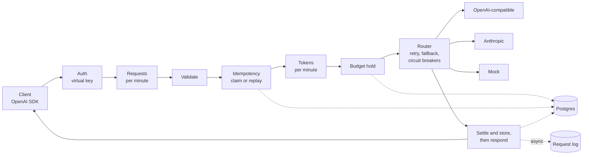
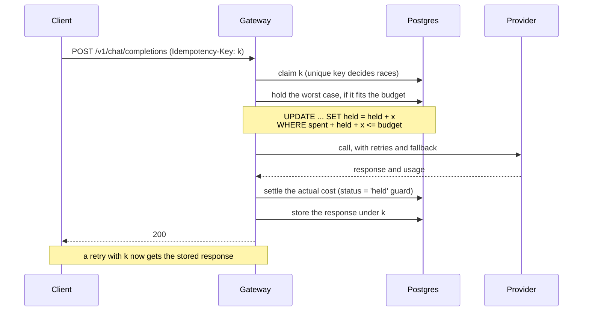

# Tollgate

Tollgate is an OpenAI-compatible LLM gateway written in Go. Point any OpenAI SDK at it: it authenticates the request with a virtual API key, enforces that key's rate limits and spend budget, routes the call to a provider with retries and fallback, streams the response back, and records what it cost.

What sets it apart is the money path. Budgets work the way card payments are authorised and captured:
- **Hold:** before a call, the gateway holds its worst-case cost against the key's budget.
- **Settle or release:** afterwards it settles the actual cost, or releases the hold if nothing was spent.
- **Sweep:** holds left behind by a crash are released when they expire.

All amounts are integer micro-dollars. Idempotency keys make retries safe, and `tollgate reconcile` checks that the books balance.



## Quickstart

You need Docker. From a clone of this repository:

```bash
docker compose up -d --build        # Postgres, migrations, the gateway on :8080, Prometheus on :9090
docker compose exec gateway tollgate keys create -name demo
```

`keys create` prints the key once. Use it as a bearer token:

```bash
KEY=tg_...   # the key printed above
curl -s localhost:8080/v1/chat/completions \
  -H "Authorization: Bearer $KEY" -H 'Content-Type: application/json' \
  -d '{"model": "mock-fast", "messages": [{"role": "user", "content": "Hello"}]}'
```

`mock-fast` is a built-in mock provider, so this works without any provider key. With the OpenAI Python SDK:

```python
from openai import OpenAI

client = OpenAI(base_url="http://localhost:8080/v1", api_key="tg_...")
stream = client.chat.completions.create(
    model="mock-fast",
    messages=[{"role": "user", "content": "Hello"}],
    stream=True,
)
for chunk in stream:
    print(chunk.choices[0].delta.content or "", end="")
```

To call a real model, put `ANTHROPIC_API_KEY` in `.env` (see `.env.example`) and use the `fast` alias. Keys can be limited to some aliases, given rate limits and a budget:

```bash
docker compose exec gateway tollgate keys create -name app -models fast -rpm 60 -tpm 100000 -budget 5.00 -period daily
docker compose exec gateway tollgate keys list
docker compose exec gateway tollgate reconcile
```

Prometheus is at http://localhost:9090: try `tollgate_http_request_duration_seconds_count` or `rate(tollgate_tokens_total[1m])`. `docker compose down` stops everything and keeps the database.

## Features

- **OpenAI-compatible API.** `POST /v1/chat/completions`, streaming and not, and `GET /v1/models`. Unsupported parameters that would change the output are rejected rather than silently dropped. Errors use OpenAI's envelope.
- **Providers.** Any OpenAI-compatible API (OpenAI, vLLM, Ollama), Anthropic's Messages API, and a mock, behind one interface. The adapters are written against raw `net/http`, with no provider SDKs.
- **Routing.** Model aliases with ordered fallback, retries with exponential backoff and full jitter, short `Retry-After`s honoured, and a circuit breaker per target. Every request is validated against every target before the first call, so a fallback never produces a 400.
- **Streaming.** A commit point at the first content: before it, failures are ordinary errors and the router can still fall back; after it, an error event. First-token, idle and total timeouts; a client that goes away cancels the upstream call; shutdown drains streams.
- **Virtual keys.** `tg_` plus 256 random bits, stored as SHA-256 hashes, managed with `tollgate keys`. Keys can be limited to some aliases, and revocation takes effect within the 30s cache TTL.
- **Rate limits.** Requests and tokens per minute per key, with token buckets. Tokens are reserved on admission and the unused part is refunded afterwards, on every exit path.
- **Budgets.** Daily or monthly, in UTC, with hold, settle, release, a sweeper for expired holds, and `tollgate reconcile`.
- **Idempotency keys.** Following the IETF draft: a retry gets the stored response, streams included, without a second provider call. A different body gets 422, and a retry while the first is running gets 409.
- **Observability.** One request-log row per chat request, written in batches without slowing requests. Prometheus metrics on a separate admin listener, with pprof. `/healthz` and `/readyz`. JSON logs that never contain keys, prompts or completions.

## The money path



- **The worst case is a real upper bound.** The input part is the UTF-8 byte count of the messages, which a byte-level tokenizer can't exceed. The output part is the request's `max_tokens`, or the alias default, which the gateway always sends upstream.
- **Holds can't oversubscribe a budget.** The hold is one conditional UPDATE: the row lock makes concurrent holds for a key take turns, so `spent + held` never passes the budget when a hold is placed. A test runs 200 concurrent requests against a budget that fits exactly 37 holds.
- **The outcome is saved before the client sees it.** For a non-streaming request, the settle and the stored response are written before the response. For a stream, they are written before the final `[DONE]`. If the process dies in between, a retry with the same key gets the stored response, not a second charge.
- **Every exit path settles or releases its hold.** That includes failures, client disconnects and panics: each step registers its own unwind with `defer`. A crash leaves the hold to the sweeper.
- **`tollgate reconcile`** checks that each period's `held` and `spent` equal the sums of its holds, and exits non-zero if they don't.

## Benchmarks

Measured on one laptop (Intel i5-12450H, 12 threads, WSL2), against a mock upstream on loopback that takes 150 ms per reply, with Postgres in Docker on the same machine:

| Measurement | Result |
|---|---|
| Overhead at the median, key without a budget | about 1.5 ms, up to 1,000 concurrent non-streaming requests (200 streaming); time to first token within 1 ms of the mock's |
| Throughput ceiling, mock that answers at once | about 25,000 requests/s through the gateway, on about 5 cores |
| Budget cost below the cap | about 8 ms at the median, for the hold and the settle |
| Budgeted throughput, per key | about 300 requests/s; see the note below |
| `tollgate reconcile` | passed after every budgeted run |

The per-key cap comes from Postgres. Each request locks its key's budget row through two commits, and each commit waits for a disk flush, which takes 1.3 ms on that machine's virtual disk. Making each budget operation a single SQL statement raised the cap from 215 to 300 requests/s, and cut the overhead at the median from 73 ms to 8 ms.

The full tables, the method and the exact commands are in [docs/BENCHMARKS.md](docs/BENCHMARKS.md). `make bench` reproduces them.

## Limitations

- **Single instance.** Rate-limit buckets, circuit breakers and the key cache live in memory. The limiter sits behind an interface, so a shared one (Redis, say) could replace it, but today two instances would each enforce the full limits.
- **Token estimates are heuristics.** Tokens per minute are reserved using about four characters per token, and provider-reported usage settles afterwards. Budget holds use the byte bound instead, which is safe for byte-level tokenizers (OpenAI's) and a documented assumption for Anthropic's.
- **One key's budgeted throughput is capped by the database.** Each budgeted request locks its key's budget row through two commits, each waiting for a disk flush, so one key can't go beyond about 1 / (2 × flush time). That is about 300 requests/s on the benchmark machine. Different keys don't contend.
- **Prompt-cache discounts aren't modelled.** Cached input tokens are charged at the full input price.
- **Failed attempts aren't charged.** If a retry or fallback follows a failed attempt that consumed tokens upstream, the gateway doesn't know what it used.
- **The settle window.** If settling fails after its retries, the failure is logged and counted, and the sweeper later releases the hold, so that spend isn't recorded.
- **Idempotent responses are stored for 24 hours,** and responses over 1 MiB aren't stored at all: a retry gets 422.
- **Request logs have no retention limit yet,** and rows are dropped under overload (counted in `tollgate_request_logs_dropped_total`).
- **The benchmarks run on one machine,** against a mock upstream on loopback.

## Roadmap

These are possible next steps, not commitments:
- a shared rate limiter for multiple instances;
- duplicate idempotent requests attached to the original instead of getting 409;
- idempotent requests finished in the background when the client disconnects;
- reconciliation against providers' own usage reports;
- tool calling, embeddings, a response cache, OpenTelemetry tracing.

## Development

Go 1.27 or newer. In WSL or Linux:

```bash
make build test lint      # tests that need Postgres run when TOLLGATE_TEST_DATABASE_URL is set (from .env)
make db migrate run       # Postgres in Docker, the migrations, then the gateway with config.yaml
make bench                # the benchmarks
make smoke                # real provider calls, with keys from .env
```

- [docs/ARCHITECTURE.md](docs/ARCHITECTURE.md): packages, the request lifecycle, the concurrency model and failure modes.
- [docs/DECISIONS.md](docs/DECISIONS.md): every non-obvious choice, with the alternatives rejected.
- [docs/BENCHMARKS.md](docs/BENCHMARKS.md): method and numbers.
- [docs/DEPLOY.md](docs/DEPLOY.md): the hosted demo on Render and Supabase.
- [docs/BRIEF.md](docs/BRIEF.md): the original specification.
